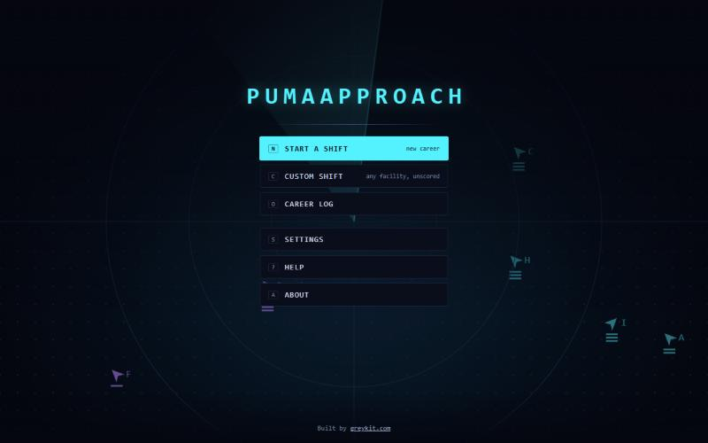
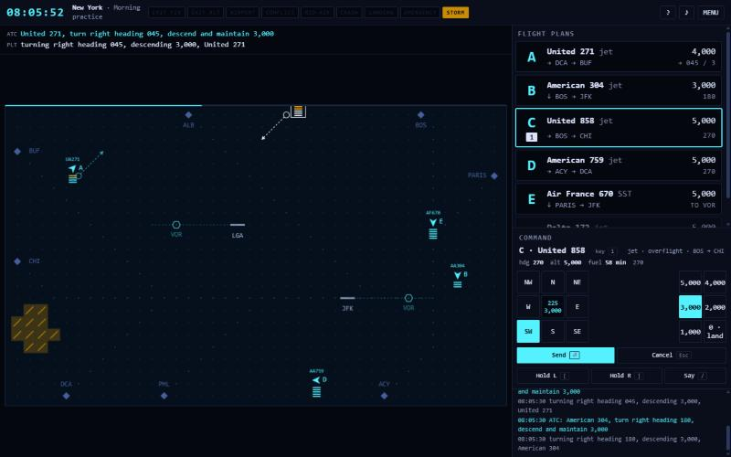

# Puma Approach

**Air traffic control on a 1985 radar scope.** A remake of *Kennedy Approach… and Beyond* (Andy Hollis, MicroProse, 1985, Commodore 64), with Puma Air on the frequency.

**Play:** [greykit.com/games/pumaapproach](https://greykit.com/games/pumaapproach/)

## How it plays

You are the approach controller. Every plane on the scope is yours until it lands or leaves through the fix on its flight plan; keep them **3 miles or 1,000 feet apart**. Arrivals hold over the VOR until cleared to land, overflights must leave at exactly 4,000 feet, and departures wait on the board for a heading and a height. A command is heading and height together; the controller speaks it, the pilot reads it back, and the plane acts at the next dot. Five facilities from Atlanta to New York, five shifts, and a career from GS-7 to GS-13 with the original's pay and promotion rules. Every shift can be replayed exactly.

**Learning**, the default, rings where each command will take hold and warns of conflicts and trouble ahead. **Classic** is the 1985 scope, where the buzzer is the first you hear of a conflict. `L` switches between them.

## Keys

The mouse picks planes; the keys set the command, in one of three layouts:

| | left hand | arrows | numpad |
|---|---|---|---|
| heading left, right | A D | ← → | 4 6 |
| height up, down | W S | ↑ ↓ | 8 5 |
| send; at height 0, clear to land | E | Enter | 7 or Enter |
| fast time, while held | Space | Space or . | 0 |

`H` lists every key; `M` is sound. On a phone the whole sector fits the screen, and **ZOOM** gives a larger mile.

## Saves

Kept in the browser's `localStorage` under keys starting `pumaapproach_`. **Settings → Forget everything** clears them.

## Credits

*Kennedy Approach* was designed by Andy Hollis for MicroProse in 1985. Puma Approach is not affiliated with MicroProse and uses none of the original's code, art, sound or text.

Working on the game: [DEVELOPMENT.md](DEVELOPMENT.md).

By Matthew "Shan" Romanek, with Claude. Built by [greykit.com](https://greykit.com/).

Made for my own play. Nothing here is offered: no support, no updates, no licence.
